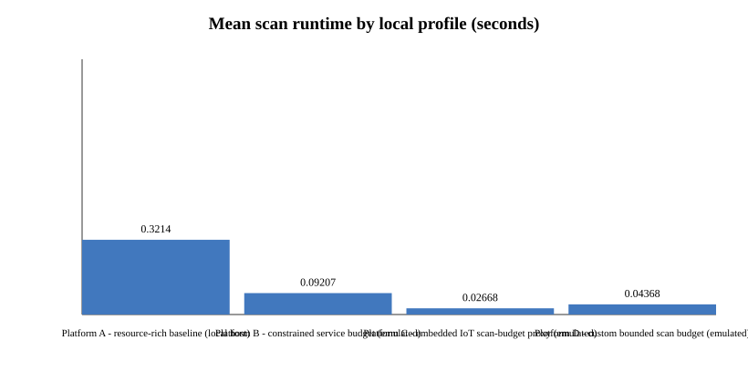
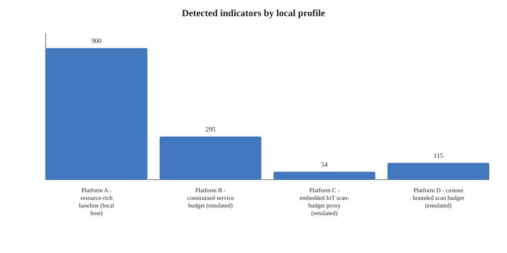
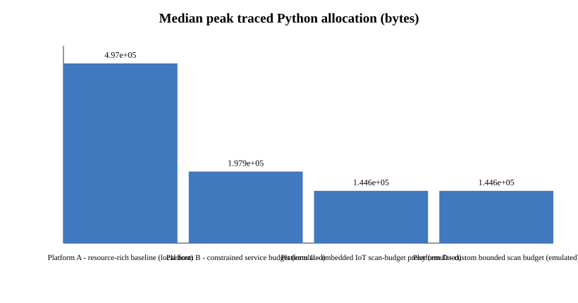
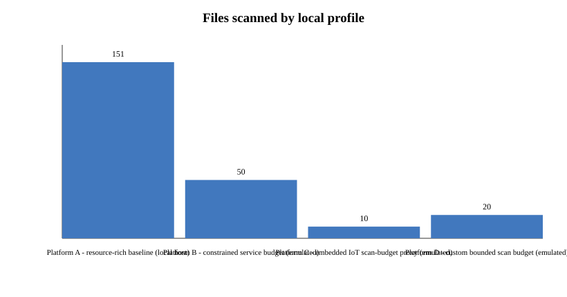

# Project Q — Crypto Inventory & Migration Planner

**Selected problem:** PS-P2 — Crypto Inventory & Migration Planner  
**Track:** Post-Quantum Cryptography  
**Stage:** Phase 1

## Purpose

This project statically scans source and configuration files for indicators of classical cryptography and post-quantum cryptography (PQC). Findings include relative path, line number, algorithm family, evidence snippet, severity/priority and migration-review guidance. The tool exports CSV/JSON findings and a Markdown/JSON risk report.

This is a source-level triage tool, not a cryptographic certification or proof that an application is secure/insecure. It does not read private key material, modify source files or perform cryptographic operations.

## Features

- Pattern-based scanning across common source/configuration extensions, including Python, Java, C/C++, JavaScript/TypeScript, Go, Rust and configuration files.
- Python AST checks for selected asymmetric-cryptography imports.
- Indicators for RSA, DSA, Diffie–Hellman, elliptic-curve cryptography, ML-KEM/Kyber, ML-DSA/Dilithium and SLH-DSA/SPHINCS+.
- CSV/JSON findings and Markdown/JSON risk reports.
- Precision/recall/F1 evaluation against explicitly labelled fixtures.
- Repeated benchmarks recording scan time, files/bytes scanned, finding count, throughput and peak Python-traced allocation.
- A/B/C/D target-platform profiles. These are transparent same-host scan-budget emulations, not measurements on separate physical machines.

## Environment and quick start

Python 3.10 or newer is recommended. The core scanner uses only the Python standard library; `requirements.txt` documents this.

```bash
python -m unittest discover -s tests -v
python main.py --self-test
python main.py --scan data/raw/labeled_corpus --out results/local_scan
python main.py --evaluate data/raw/multilang_demo --labels tests/multilang_expected_findings.json --out results/multilang_evaluation
python main.py --benchmark data/processed/benchmark_corpus --out results/final_platform_abcd_benchmark --repeats 30
```

The bundled labelled corpus and Python/Java/C demo fixtures are small, hand-labelled development fixtures. Their metrics do not estimate performance on arbitrary repositories or substitute for the organizer-provided sample/ground truth.

## Platform definitions and benchmark interpretation

The latest consolidated `Updated_Challenge_Kit.pdf` says the PQC track uses classical target Platforms A/B/C and a custom Platform D. The numeric P2 CPU/RAM budgets were not fully specified in the PDFs reviewed, so the profiles below are explicitly proposed input-budget proxies:

- **A — resource-rich reference:** scans all eligible supported files on the current host.
- **B — constrained service proxy:** at most 50 eligible files, no larger than 64 KiB each.
- **C — embedded/IoT-style proxy:** at most 10 eligible files, no larger than 64 KiB each. This is not an ARM/QEMU/Raspberry Pi measurement.
- **D — custom bounded-scan profile:** at most 20 eligible files, no larger than 16 KiB each. The selected file budget is between B and C and is intended to expose a coverage/runtime trade-off.

All four profiles run on the same host. File-count/size limits are not a simulation of CPU speed or a hard total-RAM limit. Treat the figures as a reproducible scan-budget experiment, not as proof of physical-device performance. See `platforms/platform_profiles.json` for exact settings and status labels.

## Benchmark results and figures

The current A/B/C/D benchmark tables are in [`results/final_platform_abcd_benchmark/tables/platform_comparison.csv`](results/final_platform_abcd_benchmark/tables/platform_comparison.csv) and JSON. Figures are generated from the same run:









`tracemalloc` reports Python-traced allocation, not total process memory/RSS. Runtime varies with OS, Python version, filesystem cache and load. Finding counts are not accuracy scores.

## Organizer sample and ground truth

The latest P2 description calls for scanning an organizer-provided Python/Java/C sample repository and measuring precision/recall against organizer ground truth. The supplied files available for this project did not include that planted repository or its ground-truth labels. The included demo fixtures are participant-created and are not official ground truth. When the organizer sample and labels are provided, run the scanner against those exact inputs and report the resulting metrics. Do not claim official precision/recall until then.

An optional public-repository scan can provide additional exploratory evidence, but it is not a substitute for the organizer's sample or independent labels. If no independently reviewed labels exist, report findings and scan time only.

## Migration direction

- **ML-KEM:** NIST FIPS 203, key encapsulation/key establishment.
- **ML-DSA:** NIST FIPS 204, digital signatures.
- **SLH-DSA:** NIST FIPS 205, hash-based digital signatures.

These are review directions, not drop-in substitutions. Validate protocol role, vetted libraries, interoperability, parameter sets and organizational security policy before migrating.

## Limitations

- Source-line patterns may match comments/strings and can miss aliases, wrappers, dynamic loading, binaries and dependency-mediated cryptography.
- Python AST analysis covers selected import patterns; Java and C currently use source-line rules rather than full language ASTs.
- Risk scores are heuristic priority labels, not calibrated probabilities.
- The bundled corpora are small; organizer ground-truth evaluation remains pending until the official sample/labels are available.
- The earlier participant instructions and older quantum-focused guides describe an A/B-only Phase 1 scope, while the newer consolidated kit explicitly specifies A/B/C plus custom D for the PQC track. This project follows the newer PQC-specific section and labels local profiles as emulations.

## References

See `sources.md`, `ONLINE_RESEARCH.md` and `CHALLENGE_REQUIREMENTS.md`.
